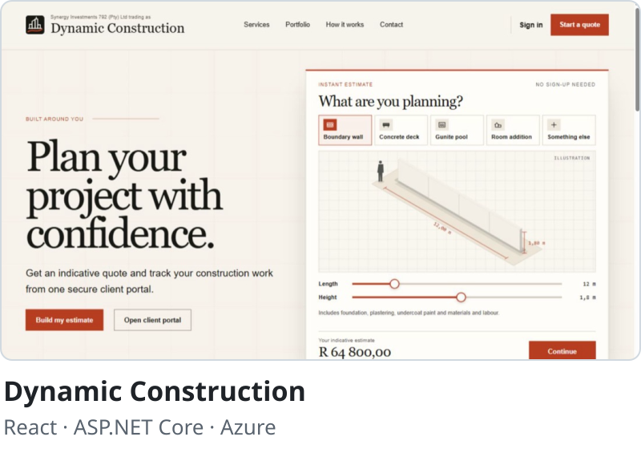
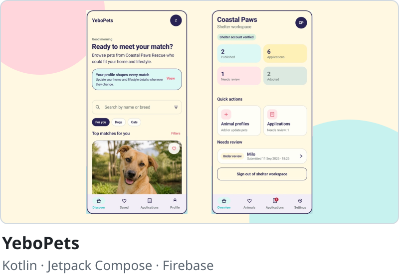
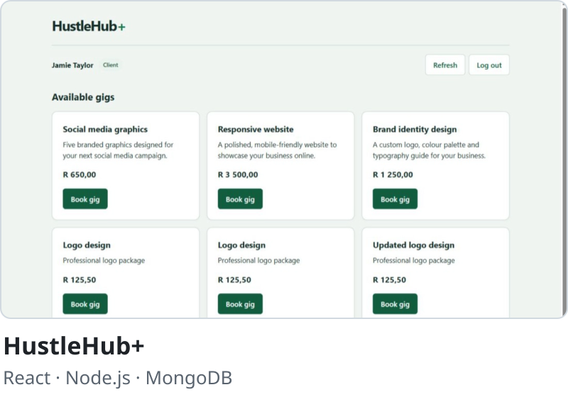
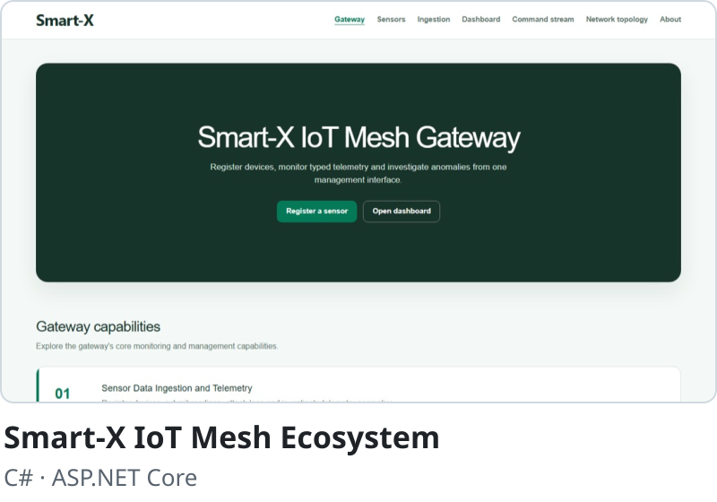

  <a href="https://zenwyn-naicker.github.io"><b>Website</b></a>
  &nbsp;·&nbsp;
  <a href="https://github.com/zenwyn-naicker/bcad-projects"><b>All projects</b></a>
  &nbsp;·&nbsp;
  <a href="https://www.linkedin.com/in/zenwyn-naicker-208079266/"><b>LinkedIn</b></a>

Final-year application development student at Emeris Durban North, building full-stack web, mobile and cloud apps with C#, .NET, React and Kotlin. Microsoft Certified: Azure Solutions Architect Expert.

## Featured projects

  
  

  
  

## Tech stack

**Languages:** C#, Java, Kotlin, TypeScript, JavaScript, SQL\
**Web:** ASP.NET Core, React, Node.js, Express\
**Mobile and desktop:** Android, Jetpack Compose, Room, WPF\
**Data:** SQL Server, Azure SQL, MongoDB, Oracle, Firestore, EF Core\
**Cloud and DevOps:** Azure, Firebase, Docker, GitHub Actions\
**Testing:** xUnit, JUnit, Vitest, Playwright

**Also:** [BCAD Year 3 Dashboard](https://zenwyn-naicker.github.io/bcad-dashboard/), a deadlines and timetable app my classmates use · [ETC ETC](https://zenwyn-naicker.github.io/etc-etc/), my final-year project team
