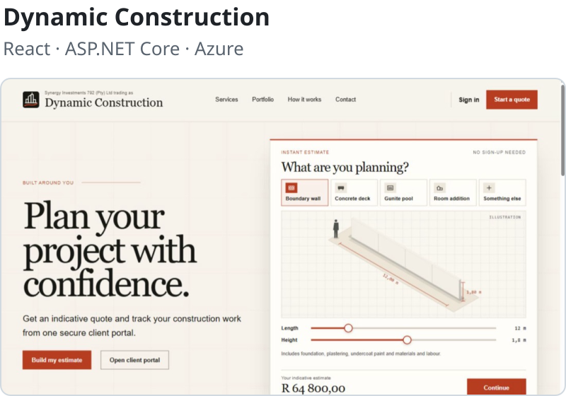
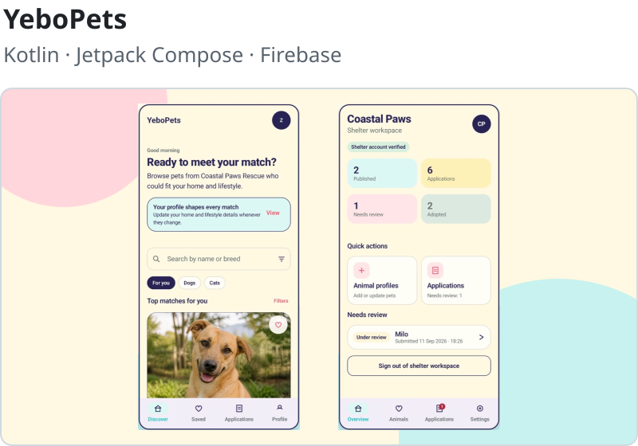
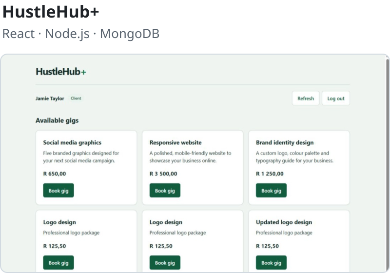
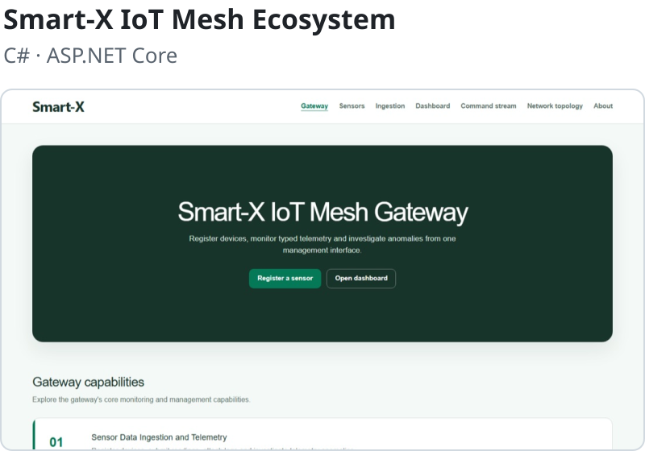
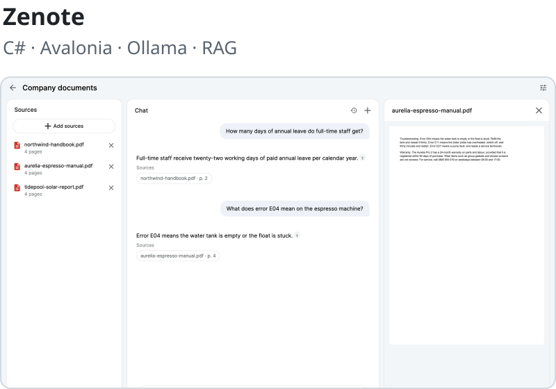
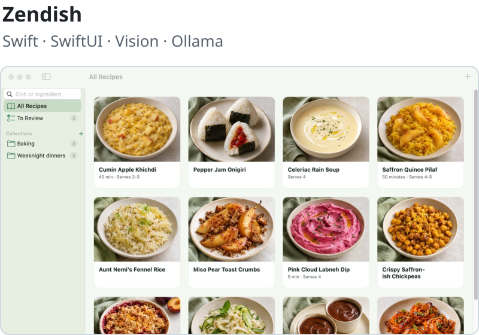

  <a href="https://zenwyn-naicker.github.io"><b>Website</b></a>
  &nbsp;·&nbsp;
  <a href="https://github.com/zenwyn-naicker/bcad-projects"><b>Campus projects</b></a>
  &nbsp;·&nbsp;
  <a href="https://www.linkedin.com/in/zenwyn-naicker-208079266/"><b>LinkedIn</b></a>

Final-year application development student at Emeris Durban North, building full-stack web, mobile and cloud apps with C#, .NET, React and Kotlin. Microsoft Certified: Azure Solutions Architect Expert.

## Featured projects

  
  

  
  

[See all my campus projects](https://github.com/zenwyn-naicker/bcad-projects)

**Also:** [BCAD Year 3 Dashboard](https://github.com/zenwyn-naicker/bcad-dashboard), a deadlines and timetable app my classmates use · [ETC ETC](https://zenwyn-naicker.github.io/etc-etc/), my final-year project team

## Building with AI

Projects where I explore and practise building with AI.

**[Zenote](https://github.com/zenwyn-naicker/zenote)** lets you chat with your PDFs on your Mac. Every answer links to the exact page it came from, and everything runs locally through Ollama, so your documents stay private.

[Download for Mac](https://github.com/zenwyn-naicker/zenote/releases/latest/download/Zenote.dmg)

 

**[Zendish](https://github.com/zenwyn-naicker/zendish)** turns recipe screenshots into a cookbook on your Mac. You check each card beside the original before saving it, and everything runs locally through Ollama, so your recipes stay private.

[Download for Mac](https://github.com/zenwyn-naicker/zendish/releases/latest/download/Zendish.dmg)

 
